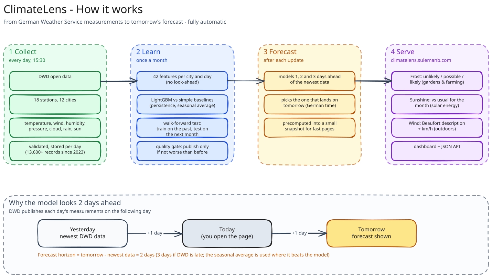
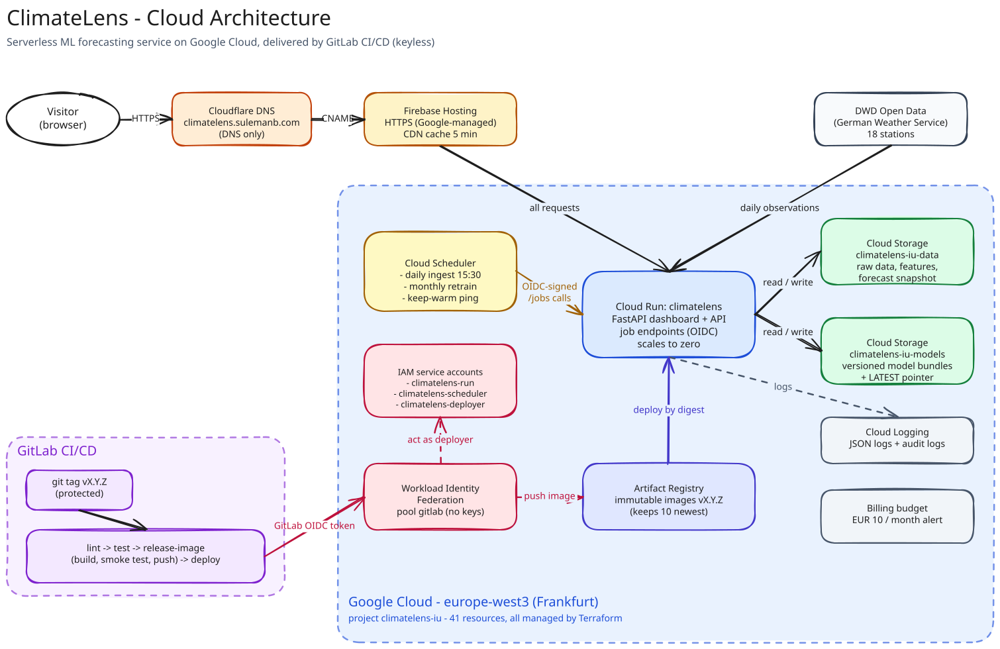

# ClimateLens

**Tomorrow's frost risk, sunshine and wind for 12 German cities - forecast by
machine learning from German Weather Service (DWD) observations.**

**Live:** [climatelens.sulemanb.com](https://climatelens.sulemanb.com)

This project is maintained on GitLab, with a mirror kept on GitHub for
visibility and easier discovery.

[](https://gitlab.com/sulemanb/devops-cloud/climatelens)
[](https://github.com/suleman-butt/climatelens)

ClimateLens was developed by Suleman Butt as part of the MSc DevOps & Cloud
Computing programme at IU International University. It demonstrates how a
machine-learning forecasting service can run reliably and fully automatically
in the cloud: data collection, retraining and releases need no manual step,
and every forecast can be traced back to the data and model version behind it.

---

## What ClimateLens forecasts

| Forecast | For whom | What you see |
|---|---|---|
| **Frost** | Gardens & farming | *Frost unlikely / possible / likely*, with the chance that tomorrow's minimum temperature drops below 0 °C |
| **Sunshine** | Solar energy | *Sunnier than usual / About usual / Duller than usual* for the month, with the expected solar energy in kWh/m² |
| **Wind** | Outdoors | A Beaufort description (e.g. *Gentle breeze*) with the average wind speed in km/h |

Cities: Berlin, Hamburg, Munich, Cologne, Frankfurt am Main, Stuttgart, Essen,
Leipzig, Bremen, Dresden, Hannover and Nuremberg.

**Using the dashboard:** pick up to three cities in the sidebar to compare them
side by side; the selection is part of the address, so a comparison can be
bookmarked. The header shows today's date and the date being forecast, and a
Light / Dark / Auto switch sets the colour theme. A machine-readable API is
documented at [`/docs`](https://climatelens.sulemanb.com/docs).

---

## How it works



1. **Collect** - every afternoon the service downloads the newest daily
   measurements (temperature, wind, humidity, pressure, cloud cover, rain,
   sunshine) from 18 DWD stations serving the 12 cities. The archive starts on
   5 September 2023 (about 13,600 daily records, 3+ years).
2. **Learn** - a gradient-boosted decision-tree model (**LightGBM**) learns how
   today's weather, the last few days and the time of year relate to the
   coming days. 42 features are built per city and day, using only data up to
   that day (no look-ahead).
3. **Forecast tomorrow** - DWD publishes each day's measurements on the
   following day, so the newest data is usually from yesterday. Models are
   therefore trained for **1, 2 and 3 days ahead** of the latest observation,
   and the service uses the one that lands on tomorrow (German time) -
   normally 2 days ahead.
4. **Stay up to date** - the forecast is refreshed daily; once a month the
   models are retrained on all data and the most accurate method per target is
   kept.

Pollen (a health perspective) was considered and dropped: the DWD observation
API provides no city-level pollen data.

---

## Evaluation

Models are evaluated with **expanding walk-forward validation**: train on all
data before a month, test on that month, repeat (22-25 monthly folds,
October 2024 - October 2026; solar has fewer because DWD publishes radiation
with a delay). Random train/test splits are not used, because
they would leak future weather into training. Every model must beat simple
baselines; where it does not, the baseline is served instead.

| Forecast | Metric | 1 day ahead | **2 days ahead** (used for tomorrow) | 3 days ahead |
|---|---|---|---|---|
| Frost | Brier score (lower is better) | 0.056 | **0.102** | 0.114 |
| | Skill vs seasonal average | +51 % | **+11 %** | 0 % (seasonal average served) |
| | Accuracy | 92 % | **86 %** | 84 % |
| Sunshine | MAE, kWh/m² | 0.84 | **0.96** | 1.02 |
| | Skill vs "same as today" | +10.5 % | **+13.6 %** | +15.0 % |
| Wind | MAE, m/s | 0.83 | **0.97** | 1.00 |
| | Skill vs "same as today" | +9.9 % | **+13.5 %** | +15.1 % (seasonal average served) |

Baselines: *persistence* (the target day equals today), *climatology*
(smoothed historical average for the city and day of year) and, for frost,
*majority class* (always "no frost"). Live scores of the served model are
available at [`/metrics`](https://climatelens.sulemanb.com/metrics). A
quality gate publishes a retrained model only if no forecast is more than 5 %
worse than the model it would replace.

---

## Cloud architecture



Editable diagram sources (Excalidraw) are in [`diagrams/`](diagrams/).

Everything runs in `europe-west3` (Frankfurt), project `climatelens-iu`.
Cloud Run scales to zero when idle. Pages stay fast because the daily and
monthly jobs precompute the forecasts into a small snapshot the website reads
(no model loading on the web path), a keep-warm ping runs during the day, and
Firebase Hosting caches pages for five minutes. Firebase Hosting fronts the service
because Cloud Run's own domain mapping is not available in this region; a
load balancer would have cost more than the whole monthly budget.

### Google Cloud resources

All 41 resources are defined in Terraform ([`infra/`](infra/)); none were
created by hand.

| Service | Resource | Purpose |
|---|---|---|
| **Cloud Run** | Service `climatelens` | Dashboard, API and the protected job endpoints; scales to zero (1 vCPU, 2 GiB) |
| | Public invoker binding | Makes the dashboard and read-only API public |
| **Cloud Storage** | Bucket `climatelens-iu-data` | Raw daily DWD partitions and the feature table (versioned, lifecycle rules) |
| | Bucket `climatelens-iu-models` | Versioned model bundles and the `LATEST` pointer |
| | Bucket `climatelens-iu-tfstate` | Terraform state (versioned) |
| **Artifact Registry** | Docker repository `climatelens` | Container images; immutable `vX.Y.Z` tags, keeps the 10 newest |
| **Cloud Scheduler** | Job `climatelens-daily-ingest` | Daily 15:30: fetch new observations, rebuild features |
| | Job `climatelens-monthly-train` | 1st of the month 11:00: evaluate, retrain, publish |
| | Job `climatelens-keep-warm` | Every 10 minutes 07:00-23:00: pings `/health` so visitors rarely meet a cold start |
| **IAM** | Service account `climatelens-run` | Runtime identity of Cloud Run; read/write on the two data buckets only |
| | Service account `climatelens-scheduler` | Signs the scheduler's OIDC tokens |
| | Service account `climatelens-deployer` | Used by GitLab CI: push images, deploy this one service |
| | 6 least-privilege role bindings | Bucket, repository, service and impersonation permissions |
| **Workload Identity Federation** | Pool `gitlab` + provider `gitlab-com` | Lets GitLab CI act as the deployer without keys - only this project, only protected tags |
| **Firebase Hosting** | Firebase project, site `climatelens-iu`, version, release | Forwards all requests to Cloud Run |
| | Custom domain `climatelens.sulemanb.com` | Google-managed HTTPS certificate |
| **Billing** | Budget alert, EUR 10/month | Email alerts at 50 / 90 / 100 % and on forecast overspend |
| **Service Usage** | 15 enabled APIs | Run, Artifact Registry, Scheduler, Storage, IAM, STS, Firebase, Billing, Logging, Monitoring, ... |

### Cost

Measured over three days of normal operation (14-17 October 2026), compared
with Google's monthly free allowances:

| Item | Measured usage | Free allowance per month | Expected cost |
|---|---|---|---|
| Cloud Run | ~260 s billable instance time/day, ~130 requests/day (incl. a ~5 min retrain per month) | 180,000 vCPU-s, 360,000 GiB-s, 2 M requests | EUR 0 (under 10 % of the allowance) |
| Cloud Scheduler | 3 jobs | 3 jobs per billing account | EUR 0 |
| Cloud Storage | ~23 MB in three buckets | - | < EUR 0.01 |
| Artifact Registry | ~1-1.5 GB (10 newest images, layers shared) | 0.5 GB | ~EUR 0.10-0.15 |
| Firebase Hosting, Logging, Workload Identity | small | generous free tiers | EUR 0 |

**Actual cost, 1-17 October 2026 (Google Cloud Billing): EUR 0.00** - Cloud
Run used EUR 0.02, fully covered by the free tier; Cloud Storage, Cloud
Scheduler, Cloud Logging and Artifact Registry EUR 0.00 each.

Expected steady state: **well under EUR 1 per month**, mostly image storage. A
EUR 10 monthly budget alert (counting usage before credits) guards against
surprises; it notifies, it does not cap spending. Actual charges are visible
in the Google Cloud console under Billing > Reports.

---

## DevOps practices

- **Infrastructure as code:** two-stage Terraform - a small bootstrap creates
  the state bucket, the main configuration everything else. The budget alert
  is created before any billable service.
- **CI/CD (GitLab):** every code change runs lint, tests (99 automated tests)
  and a container build with smoke test. A release is a protected git tag
  `vX.Y.Z`: the pipeline checks the tag against the code version, builds and
  tests the image, pushes it with an immutable tag and deploys exactly that
  image (by digest) to Cloud Run, then checks the live site.
- **No secrets or keys:** GitLab CI authenticates through Workload Identity
  Federation with short-lived tokens; Cloud Run and Scheduler use attached
  service accounts; the scheduler's calls to `/jobs/*` carry Google-signed
  tokens that the service verifies.
- **Least privilege:** one service account per role, each limited to the
  resources it needs.
- **Reproducibility:** every dependency pinned with hashes; deterministic
  training (retraining on the same data gives identical models); versioned,
  immutable model bundles that record their training data, parameters and
  evaluation.
- **Fast cold starts:** forecasts are precomputed into a snapshot after each
  ingest and retrain, so a new instance serves from one small file instead of
  loading models (service load ~3 s -> ~0 s).
- **Reliability:** a missed daily run is caught up automatically; running
  instances pick up new data and models within a minute; a quality gate
  blocks worse models; the non-root container fails closed when no model is
  available.

---

## Run it yourself

Requirements: Python 3.12, Docker; Terraform and the Google Cloud CLI for the
cloud part.

```bash
make install                              # dependencies (hash-locked)
make test                                 # automated tests, offline
climatelens ingest --backfill-years 3     # download 3 years of DWD data
climatelens features                      # build the feature table
climatelens train                         # walk-forward evaluation + training
make serve                                # dashboard on http://localhost:8000
```

Container: `make build`, then `make run` (dashboard on http://localhost:8080).

Cloud: `infra/bootstrap` once, then `terraform apply` in `infra/`. Releases:
bump the version in `src/climatelens/__init__.py`, commit, and run
`make release`; GitLab CI deploys it.

### Teardown

At the end of the course the whole deployment can be removed without leftover
costs:

1. **Delete the project (complete, recommended):**
   `gcloud projects delete climatelens-iu` stops all billing at once and removes
   every resource listed above; Google keeps the project recoverable for 30
   days.
2. **Or keep the project and remove the resources:** empty the data and models
   buckets including old versions
   (`gcloud storage rm -r --all-versions gs://climatelens-iu-data/** gs://climatelens-iu-models/**`),
   run `make destroy` (Terraform destroys the main configuration), then empty
   the state bucket the same way and run `terraform destroy` in `infra/bootstrap`. The
   Firebase project link and the Workload Identity pool are soft-deleted by
   Google (pool IDs stay reserved for 30 days).
3. **Outside Google Cloud:** delete the `climatelens` CNAME and the
   `_acme-challenge.climatelens` TXT record at Cloudflare, and optionally the
   protected `v*` tag rule in GitLab.

The bootstrap configuration keeps its small state file locally (it is not in
git). If it is lost, nothing breaks: the state bucket can be deleted by hand
or re-imported with `terraform import`.

---

## API

| Path | Description |
|---|---|
| `/` | Dashboard |
| `/forecast`, `/forecast/{city}` | Forecasts for tomorrow (JSON), e.g. `/forecast/berlin` |
| `/cities` | The 12 cities and their DWD stations |
| `/metrics` | Walk-forward scores of the served models vs baselines |
| `/health` | Liveness |
| `/docs` | Interactive API documentation |

---

## Documentation

- [Decision log](docs/decisions.md) - every significant design decision with
  the alternatives considered and the reasoning
- [Project log](docs/project-log.md) - how the system was built, phase by
  phase, with measurements and the problems solved along the way
- [Evaluation results](docs/evaluation-results.md) - walk-forward scores by
  forecast horizon and per city
- [Changelog](CHANGELOG.md) - what changed in each release
- [Diagrams](diagrams/) - editable Excalidraw sources of the figures above

---

## Responsible use

ClimateLens is a technical demonstrator for educational and research
purposes. Its forecasts are statistical estimates and must not be relied on
for medical, agricultural or safety-critical decisions. For official forecasts
and warnings, consult the [Deutscher Wetterdienst](https://www.dwd.de).

Data source: Deutscher Wetterdienst (DWD), open data.

## Author and licence

Suleman Butt - MSc DevOps & Cloud Computing, IU International University.
Licensed under the MIT License, see [`LICENSE`](LICENSE).
